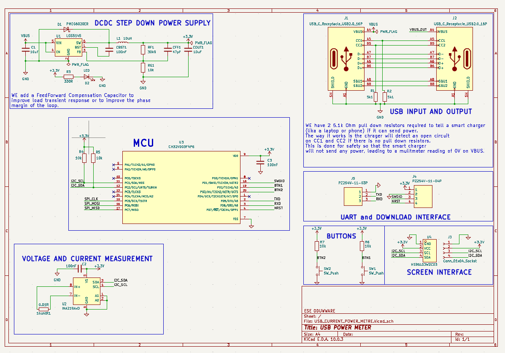

# USB-C Power Meter (CH32V003 + INA219 + SSD1306)

A custom USB-C power meter engineered around the **WCH CH32V003** 32-bit RISC-V microcontroller. Placed inline between a USB-C power adapter and a downstream device (such as a smartphone, tablet, or laptop), it continuously monitors real time bus voltage ($V$), load current ($I$), and power consumption ($W$), rendering live electrical metrics and an oscilloscope-style rolling power graph onto a 0.96" OLED display.

Main Resourcesused to learn: https://ohdarling88.medium.com/diy-usb-current-meter-1-component-selection-and-schematic-design-95a2203fb45d
 and https://www.youtube.com/watch?v=AaFnhHrfWs4&t=2256s

---

## 📋 Table of Contents
1. [System Overview & Key Features](#-system-overview--key-features)
2. [Hardware Architecture & Circuit Design](#️-hardware-architecture--circuit-design)
3. [Engineering Calculations & Component Selection](#-engineering-calculations--component-selection)
4. [Low-Level I2C Protocol & Register Mechanics](#-low-level-i2c-protocol--register-mechanics)
5. [Firmware Architecture & Memory Optimization](#-firmware-architecture--memory-optimization)
6. [Calibration & Verification Procedure](#-calibration--verification-procedure)
7. [Repository Structure](#-repository-structure)
8. [References & Datasheets](#-references--datasheets)

---

## 🌟 System Overview & Key Features

* **Inline High-Side Current Sensing:** Measures current directly on the `VBUS` path using a precision **$0.01\,\Omega$ (10 m$\Omega$) shunt resistor** paired with the TI INA219, keeping insertion loss and voltage drop negligible even during high-current charging.
* **Dual-Page User Interface:** An active-low tactile push button on `PD2` (configured with internal pull-up) toggles cleanly between two display views:
  * **Page 0 (Telemetry View):** Displays real-time Voltage (`V`), Current (`I`), and Power (`P`) formatted to two decimal places.
  * **Page 1 (Graph View):** Renders a 128-column rolling power history graph across the bottom 32 pixels of the screen (`Pages 4–7`).
* **Bare-Metal C Firmware:** Built directly on the WCH peripheral library without bloated third-party graphics frameworks, fitting comfortably within the CH32V003's **16 KB Flash** and **2 KB SRAM**.

---

## 🛠️ Hardware Architecture & Circuit Design

### Bill of Materials & Pinout Summary

| Subsystem | Component | Interface / Address | MCU Pin Mapping | Notes |
| :--- | :--- | :--- | :--- | :--- |
| **Microcontroller** | WCH CH32V003 | 48 MHz RISC-V Core | — | Powered by $3.3\,\text{V}$ rail |
| **Current / Power Sensor** | TI INA219 | I2C1 (`0x40`) | `PC1` (SDA), `PC2` (SCL) | `A0` & `A1` tied to `GND` |
| **OLED Display** | SSD1306 (HS96L03W2C03 128x64) | I2C1 (`0x3C`) | `PC1` (SDA), `PC2` (SCL) | Shared 400 kHz Fast-Mode I2C bus |
| **Step-Down Regulator** | LGS5145 Buck Converter | Analog Feedback | — | Steps `VBUS` down to $3.32\,\text{V}$ |
| **User Input** | Tactile Push Buttons | GPIO Input (`IPU`) | `PD2 & PD3` | Active-low with 250 ms debounce |
| **Debug UART** | CH340 / WCH-LinkE | USART1 (115200 baud) | `PD5` (TX), `PD6` (RX) | Serial diagnostics |

---

### 1. USB-C Pass-Through & CC Line Topology
* **VBUS Power Path:** The incoming `VBUS` line from the input receptacle (`J1`) is routed through the **$0.01\,\Omega$ shunt resistor** to the output receptacle (`J2`, `VBUS_OUT`). The INA219 `VIN+` pin senses the upstream side of the shunt, and `VIN-` senses the downstream side.
* **Configuration Channel (CC1 / CC2) Signaling:** Two **$5.1\,\text{k}\Omega$ pull-down resistors** connect `CC1` and `CC2` to `GND` on the input side (`J1`), while `CC1` and `CC2` pass straight through from `J1` to `J2`. The $5.1\,\text{k}\Omega$ pull-downs identify the meter as a valid USB-C sink so smart chargers enable `5V VBUS` regardless of cable orientation, while the pass-through lines preserve downstream device communication.

### 2. Step-Down Power Supply (`LGS5145`)
To power the CH32V003, INA219, and SSD1306 safely from the USB `VBUS` line, an **LGS5145** buck converter steps the input down to a regulated **$3.3\,\text{V}$ rail** using a $10\,\mu\text{H}$–$22\,\mu\text{H}$ power inductor, an `SS14` Schottky catch diode, and $10\,\mu\text{F}$ input/output ceramic capacitors.

### Schematic Diagram


---

## 📐 Engineering Calculations & Component Selection

### 1. LGS5145 Buck Converter Feedback Divider
The LGS5145 uses an internal feedback reference voltage of $V_{\text{FB}} = 0.812\,\text{V}$. In reference designs, omitting the `+ 1` term from the non-inverting feedback equation ($0.812 \times \frac{40\text{k}}{10\text{k}} = 3.248\,\text{V}$) under-drives a $3.3\,\text{V}$ rail. Using the true datasheet formula:

$$V_{\text{OUT}} = V_{\text{FB}} \times \left(1 + \frac{R_f}{R_g}\right)$$

Selecting standard 1% E96 resistors **$R_f = 30.9\,\text{k}\Omega$** and **$R_g = 10\,\text{k}\Omega$** yields:

$$V_{\text{OUT}} = 0.812\,\text{V} \times \left(1 + \frac{30.9\,\text{k}\Omega}{10\,\text{k}\Omega}\right) = \mathbf{3.321\,\text{V}}$$

---

### 2. INA219 Calibration Register (`0x05`) & Current LSB
Because the INA219 calculates current and power internally in hardware, Register `0x05` must be programmed at startup with a scaling factor derived from the shunt resistance ($R_{\text{SHUNT}} = 0.01\,\Omega$) and maximum expected current ($I_{\text{MAX}} = 3.2\,\text{A}$):

1. **Current Resolution (`Current_LSB`):**
   $$\text{CurrentLSB} = \frac{I_{\text{MAX}}}{2^{15}} = \frac{3.2\,\text{A}}{32768} \approx 0.00009765625\,\text{A/bit}$$

2. **Calibration Register Value:**
   $$\text{Cal} = \text{trunc}\left(\frac{0.04096}{\text{CurrentLSB} \times R_{\text{SHUNT}}}\right) = \text{trunc}\left(\frac{0.04096}{0.00009765625 \times 0.01}\right) = 41943 \quad (\text{0xA3D7})$$
---

### 3. Bus Voltage, Current, and Power Conversions
* **Bus Voltage (`Register 0x02`):** The lower 3 bits (`[2:0]`) are status flags (`CNVR` and `OVF`). Shifting right by 3 isolates the 13-bit voltage reading, where each LSB equals $4\,\text{mV}$:
  $$V_{\text{BUS}} = \frac{(\text{rawBusVolt} \gg 3) \times 4.0}{1000.0}$$
* **Load Current (`Register 0x04`):** Read as a signed 16-bit integer (`int16_t`) and multiplied directly by $\text{CurrentLSB}$:
  $$I_{\text{LOAD}} = \text{rawCurrent} \times 0.00009765625$$
* **Instantaneous Power:**
  $$P = V_{\text{BUS}} \times I_{\text{LOAD}}$$

---

## 🔌 Low-Level I2C Protocol & Register Mechanics

Both peripherals share **I2C1 (`PC1` = SDA, `PC2` = SCL)** configured in **400 kHz Fast Mode** (`I2C_DutyCycle_16_9`).

### 1. INA219 16-Bit Register Read Sequence
The INA219 stores measurements in 16-bit registers (MSB first). Reading a register requires a **Write-Pointer + Repeated-Start** transaction with strict hardware ACK/STOP timing on the CH32V003:

```text
[START] -> [0x40 + W] -> [Reg Pointer] -> [REPEATED START] -> [0x40 + R] -> [MSB] -> (Disable ACK + Queue STOP) -> [LSB] -> [STOP]
